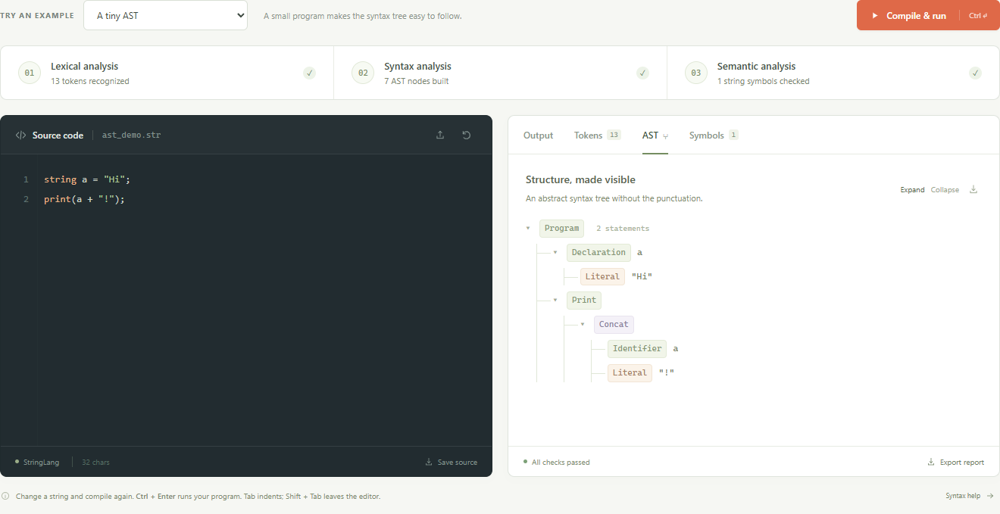

# StringLab String Processing Mini Compiler

Compiler Design Mini Project Report

Implementation HTML CSS and JavaScript

Project Based Learning Activity

Presentation and demonstration 23 October 2026

College and department To be completed by the group

Faculty and group number To be completed by the group

Members and roll numbers See the contribution sheet

## Abstract
StringLab is a static browser application implementing a compiler front end for a small string-processing language. It supports string declarations, assignment, concatenation and output. A JavaScript lexer validates literals and escape sequences and produces positioned tokens. A recursive-descent parser constructs an abstract syntax tree from a transformed LL(1) grammar. Semantic analysis checks declarations, initialization, duplicate names and string lengths. A separate interpreter previews only accepted programs. The browser interface makes each phase visible without requiring a backend, database or installation.

## Objectives
The project connects CFG transformations to a working parser and explains lexical, syntax and semantic analysis through editable examples. Students can inspect tokens, explore an AST, review a symbol table and compare errors at different phases. The complete application is portable static files that can open directly from disk or deploy to a static host.

<!-- pagebreak -->

# Language Specification

All variables have string type and one global scope. Names are case sensitive and match [A-Za-z_][A-Za-z0-9_]*. The keywords are string and print. A declaration may initialize a variable or leave it uninitialized. Reading an uninitialized variable is a semantic error. Assignment updates an existing declaration. The + operator concatenates strings and parentheses group expressions. Every statement ends with a semicolon. Comments begin with // outside literals. Each print adds a newline.

```text
string name = "World";
string greeting;
greeting = "Hello, " + name + "!";
print(greeting);
```

This example prints Hello, World!. Empty programs and empty strings are valid. Numeric literals and single-quoted strings are outside the language.

## String literals and escapes
Strings use double quotes. Raw line breaks, unsupported escapes, unescaped ASCII controls and missing closing quotes are lexical errors. Escape decoding happens exactly once.

| Escape in source | Decoded meaning |
| --- | --- |
| \n | Newline |
| \t | Horizontal tab |
| \r | Carriage return |
| \\ | Backslash |
| \" | Double quote |

JavaScript preserves Unicode string content. Length limits and source columns use UTF-16 code units, not bytes or displayed glyph counts. CRLF counts as one newline. An initial BOM is accepted. NUL is rejected anywhere in the source, including strings and comments.

<!-- pagebreak -->

# Browser Architecture and Lexical Analysis

The application consists of five static files. index.html defines the page and dialogs, styles.css handles the responsive layout, examples.js embeds offline examples, compiler.js implements the language, and app.js manages the interface. There are no runtime packages or remote compiler services. Opening index.html directly is sufficient.

## Compilation pipeline
The editor passes a source string to compileSource. The engine returns a serializable result containing success status, phase states, tokens, an AST, symbols, diagnostics and output. Every compilation owns its state. The lexer and parser stop on a fatal error. Semantic analysis can collect several independent errors. A failed phase prevents preview execution.

## Lexer
The lexer scans characters once, skips whitespace and line comments, reads complete identifiers before classifying keywords and validates double-quoted literals. An escape map converts the five accepted sequences. Tokens preserve both the raw lexeme and decoded value with one-based line and column locations. The EOF token makes end-of-input checks explicit.

| Token kind | Example |
| --- | --- |
| STRING or PRINT | string, print |
| IDENTIFIER | name, greeting |
| STRING_LITERAL | "Hello" |
| EQUAL or PLUS | =, + |
| LPAREN RPAREN SEMICOLON | (, ), ; |
| EOF | End of source |

The identifier stringer remains one identifier. A // sequence inside a quoted string remains literal content. Source text is never executed as JavaScript.

<!-- pagebreak -->

# CFG and Grammar Transformations

The original CFG contains immediate left recursion and a common declaration prefix. Here epsilon denotes the empty production.

```text
Program -> Program Stmt | epsilon
Stmt    -> Decl | Assign | Output
Decl    -> 'string' id ';'
         | 'string' id '=' Expr ';'
Assign  -> id '=' Expr ';'
Output  -> 'print' '(' Expr ')' ';'
Expr    -> Expr '+' Term | Term
Term    -> literal | id | '(' Expr ')'
```

## Removing left recursion
For A -> A alpha | beta, use A -> beta A-prime and A-prime -> alpha A-prime | epsilon. For Program, simplifying its empty base yields a zero-or-more statement list.

```text
Program  -> List
List     -> Stmt List | epsilon
Expr     -> Term ExprTail
ExprTail -> '+' Term ExprTail | epsilon
```

The parser implements repetitions with loops. The expression loop folds each new operand into a left child, preserving a + b + c as Concat(Concat(a,b),c).

## Left factoring declarations
Both declaration alternatives share string id. The next token then selects an initializer or the ending semicolon.

```text
Decl -> 'string' id Init ';'
Init -> '=' Expr | epsilon
```

The complete transformed grammar appears in the application language guide and docs/grammar.md.

<!-- pagebreak -->

# Predictive Parsing and the AST

The transformed grammar is LL(1). Distinct first tokens select declaration, assignment or output. Nullable List, Init and ExprTail alternatives have no FIRST/FOLLOW conflicts.

| Nonterminal | FIRST | FOLLOW |
| --- | --- | --- |
| Program and List | string, id, print, epsilon | $ |
| Stmt | string, id, print | string, id, print, $ |
| Decl | string | string, id, print, $ |
| Assign | id | string, id, print, $ |
| Output | print | string, id, print, $ |
| Init | =, epsilon | ; |
| Expr | literal, id, ( | ;, ) |
| ExprTail | +, epsilon | ;, ) |
| Term | literal, id, ( | +, ;, ) |

The parser uses statement, expression and primary functions. An expect helper checks required punctuation and reports a positioned syntax error. Program stores statements in an ordered body array. Declarations, assignments and print nodes contain expressions. Concat has left and right children. Literal and Identifier are leaves.

```text
Program
  Declaration a
    Literal "Hi"
  Print
    Concat
      Identifier a
      Literal "!"
```

The AST above represents string a = "Hi"; followed by print(a + "!");. It omits punctuation and grammar helper nodes. The browser displays it as an expandable tree and offers JSON export.

<!-- pagebreak -->

# Semantic Analysis and Preview

The analyzer visits statements in source order and stores symbols in a Map. A declaration inserts an initially uninitialized symbol, then checks its initializer. Therefore string x = x; is invalid. Assignment requires a prior declaration. Identifier expressions require declaration and initialization. Duplicate declarations report the original declaration line and do not replace it. Failed initializers or assignments do not initialize a previously uninitialized variable.

String is the only type. The grammar permits string literals, identifiers and concatenation. Semantic analysis checks usable string identifiers and computes expression lengths. Concatenated values exceeding 1,023 UTF-16 code units are rejected before execution.

## Preview interpreter
After all three phases succeed, the interpreter evaluates the AST from top to bottom. A separate value Map handles literals, identifier reads, concatenation, assignments and output. Output accumulates as strings and is rendered only for accepted programs. There is no eval or Function call and no machine-code generation.

## Browser interaction
Source changes invalidate old results and disable result exports until recompilation. The interface uses textContent and text nodes for source, literals, token values and diagnostics, so quoted HTML remains data. Maps make names such as constructor and __proto__ ordinary identifiers. File import reads a user-selected file locally. Blob downloads save source, AST or a complete report without remote storage.



Figure 1. Actual browser capture of the source and interactive AST views.

<!-- pagebreak -->

# Application Demonstration

Open index.html directly or visit the deployed static page. The default program compiles automatically. Choose an example, edit a string and press Compile and run or Ctrl/Cmd + Enter. The phase strip shows passed, failed and skipped phases. Tabs display output, positioned tokens, an expandable AST and symbols. Token and diagnostic locations select the corresponding source text.


Figure 2. Actual browser capture of a successful program and its output.

## Demonstration sequence
Run Hello world, inspect Tokens, choose A tiny AST and expand the tree, then inspect Symbols. Choose Escape sequences to show decoded literals. Finally select the lexical, syntax and semantic error examples and explain why no preview runs after failure. Open Language guide to discuss transformations. Export a report and source file to demonstrate local downloads.

The interface adapts to mobile screens. Native dialogs and keyboard-controlled tabs support navigation. In the editor, Tab inserts spaces and Shift + Tab moves focus out.

<!-- pagebreak -->

# Testing and Diagnostics

The core suite uses Node's built-in test runner and contains 29 tests, several with multiple cases. Node is a development tool only. The browser application has no Node runtime dependency. The tests cover valid language behavior, escapes, empty inputs, Unicode strings, comments, CRLF, syntax and semantic failures, source locations, limits, state isolation and report serialization.

Browser checks additionally exercise result tabs, AST expansion and collapse, all error examples, keyboard compilation, file import, source/AST/report downloads, stale results, inert HTML strings, dialogs, mobile overflow and direct file:// opening. All checks passed during preparation on 20 October 2026.


Figure 3. Actual browser capture showing three independent semantic errors and no output preview.

Diagnostics include the phase, a message, source line and one-based location. Clicking the location highlights the relevant source. Lexical or syntax failure stops later phases. Semantic analysis can report multiple errors. A NUL-in-comment regression test verified that NUL is rejected anywhere in source.

<!-- pagebreak -->

# Deployment Limits and Contributions

The complete frontend can open directly from index.html with its adjacent CSS and JavaScript files. For a clean static upload folder, npm run build copies the application and project downloads into dist. This step is optional and uses no package installation. A static host serves these files while the browser performs all compiler work. No backend, database, API key, environment variable or application server is required.

Programs and results remain in the current page's memory unless downloaded. A hosted first load needs a network connection to retrieve assets. Download the complete folder for guaranteed offline use. The project README documents static deployment and links to official hosting instructions.

| Resource | Limit |
| --- | --- |
| Source | 65,535 UTF-16 code units |
| Tokens and AST nodes | 4,096 each, including EOF in the token count |
| Symbols and ASCII identifier | 256 symbols and 63 characters per identifier |
| Literal or concatenated value | 1,023 UTF-16 code units |
| Parenthesis nesting and expression depth | 128 |

The language has one global scope and no numeric types, input, loops, functions, optimization or machine-code generation.

## Individual contribution sheet
Enter actual work and corresponding evidence. Add or remove rows to match the allotted group. Complete institution, faculty and group details before submission.

| Name and roll number | Actual work and evidence |
| --- | --- |
| To be completed | To be completed |
| To be completed | To be completed |
| To be completed | To be completed |
| To be completed | To be completed |

The full contribution log is docs/contributions.md. The source language requirements come from the supplied topic. Screenshots and test evidence come from this browser implementation. Review and understand the assistant-prepared materials and follow institutional disclosure requirements.
