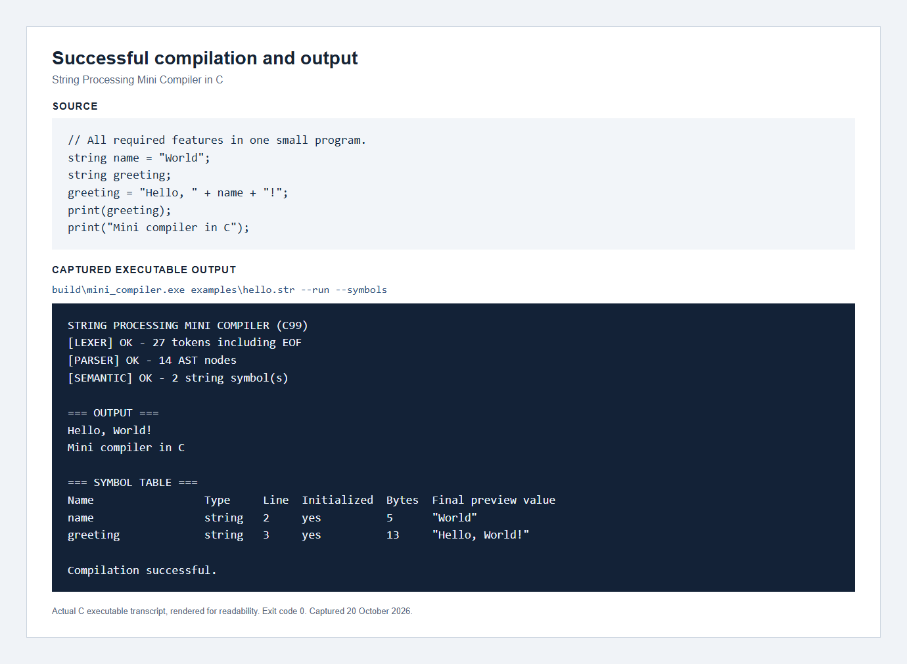
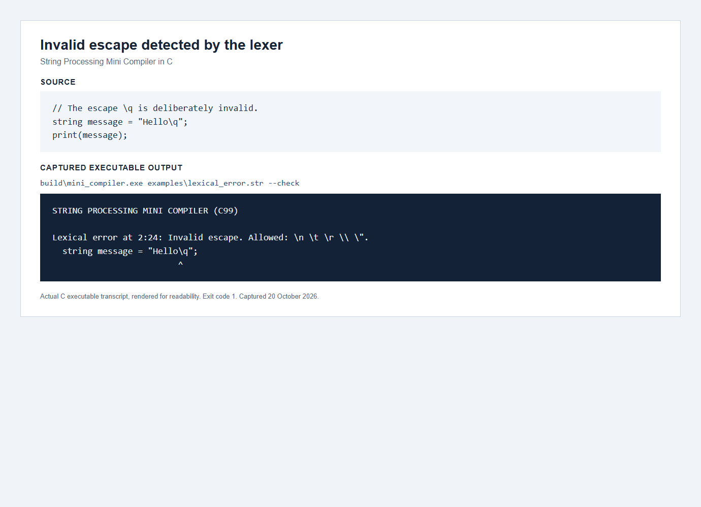
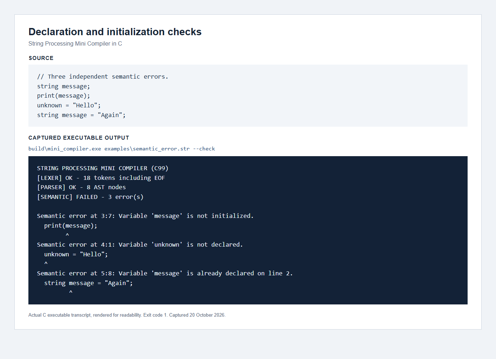

# String Processing Mini Compiler

Compiler Design Mini Project Report

Implementation language: C99

Project Based Learning Activity

Presentation and demonstration: 23 October 2026

College and department: To be completed by the group

Group number and faculty: To be completed by the group

Member names and roll numbers: See the contribution sheet

## Abstract

This project implements a compiler front end for a small string-processing language in standard C. The language supports string declarations, assignment, concatenation and string-output statements. The front end scans source text into positioned tokens, constructs an abstract syntax tree using recursive descent, and performs semantic checks with a symbol table. It validates string delimiters and escape sequences, reports useful diagnostics and prevents execution when compilation fails. A separate interpreter previews accepted programs. The implementation uses one C source file divided into compiler phases and requires no third-party runtime libraries.

## Objectives

The project demonstrates lexical, syntax and semantic analysis through a small working language. Its main educational objective is to connect a CFG and its transformations to an understandable parser and AST. The source, examples, tests, grammar notes, screenshots and presentation support a reproducible classroom demonstration.

<!-- pagebreak -->

# Language Specification

All variables have string type and one global scope. Identifiers are case sensitive and match the pattern [A-Za-z_][A-Za-z0-9_]*. The keywords are string and print. A declaration may include an initializer or leave the variable uninitialized. Reading an uninitialized variable is a semantic error. Assignment updates an existing variable. The + operator concatenates strings, and parentheses group expressions. Each print statement adds a newline. Every statement ends with a semicolon. Comments begin with // outside string literals and continue to the end of the line.

```text
string name = "World";
string greeting;
greeting = "Hello, " + name + "!";
print(greeting);
```

The example prints Hello, World!. It demonstrates initialized and uninitialized declarations, assignment, concatenation and output. Empty programs and empty strings are also valid.

## String literals and escapes

String literals use double quotes. Raw line breaks, unescaped ASCII control characters, invalid escapes and missing closing quotes are lexical errors. Escape sequences decode exactly once.

| Source escape | Decoded meaning |
| --- | --- |
| \n | Newline |
| \t | Horizontal tab |
| \r | Carriage return |
| \\ | Backslash |
| \" | Double quote |

For example, print("A\nB"); produces two lines. The source string "\\n" contains a backslash followed by n after decoding. Single quotes and numeric literals are outside the language. UTF-8 string bytes pass through unchanged, but the compiler does not validate Unicode encoding. Locations use one-based lines and byte columns.

<!-- pagebreak -->

# Architecture and Lexical Analysis

The pipeline reads a source file, performs lexical analysis, parses tokens into an AST, and checks semantics. Only a successful pipeline enables preview execution. src/mini_compiler.c contains all runtime code in labeled sections. The standard C library supplies file handling, strings and diagnostics. setjmp and longjmp stop the lexer or parser after a fatal error without requiring error returns through every recursive parser function. Semantic analysis collects several errors in one pass.

## Data structures

Token stores the token kind, raw source span, decoded text and source location. Node stores an AST kind, token reference, expression children and a next pointer connecting statements. Symbol stores the name, declaration line, initialization state, string length and preview value. Fixed arrays hold these records, and explicit checks enforce their limits.

## Lexer algorithm

The lexer advances through the source once. It skips whitespace and line comments, reads a complete identifier before recognizing keywords, and handles double-quoted literals with a separate escape state. It recognizes punctuation directly and rejects unexpected characters. Raw source spans remain available for the token display even though literal values are already decoded. CRLF advances one line. The file reader accepts an optional UTF-8 BOM and rejects embedded NUL bytes.

| Token category | Example |
| --- | --- |
| Keyword | string, print |
| Identifier | name, greeting |
| String literal | "Hello" |
| Assignment and concatenation | =, + |
| Delimiter | (, ), ; |
| End of input | EOF |

Reading an identifier before keyword comparison ensures that stringer is one identifier rather than the keyword string followed by another token. The sequence // inside a quoted string remains literal text.

<!-- pagebreak -->

# CFG and Grammar Transformations

The initial grammar expresses repeated statements and concatenation with immediate left recursion. It also gives declarations two alternatives with a common prefix. Here id and literal are lexer tokens, and epsilon means the empty production.

```text
Program -> Program Stmt | epsilon
Stmt    -> Decl | Assign | Output
Decl    -> 'string' id ';'
         | 'string' id '=' Expr ';'
Assign  -> id '=' Expr ';'
Output  -> 'print' '(' Expr ')' ';'
Expr    -> Expr '+' Term | Term
Term    -> literal | id | '(' Expr ')'
```

## Removing immediate left recursion

A direct recursive-descent implementation of Expr calling Expr before consuming input would recurse indefinitely. Applying A -> A alpha | beta gives A -> beta A-prime and A-prime -> alpha A-prime | epsilon.

```text
Expr     -> Term ExprTail
ExprTail -> '+' Term ExprTail | epsilon
Program  -> List
List     -> Stmt List | epsilon
```

The original Program rule has epsilon as its nonrecursive alternative. Removing its left recursion and simplifying the empty prefix yields the zero-or-more statement list above. The implementation uses loops for both repetitions. The expression loop builds a left-associated AST, so a + b + c becomes Concat(Concat(a,b),c).

## Left factoring declarations

Both declaration forms share the prefix string id. Factoring postpones the choice until the next token:

```text
Decl -> 'string' id Init ';'
Init -> '=' Expr | epsilon
```

The complete grammar and derivation are retained separately in docs/grammar.md.

<!-- pagebreak -->

# Predictive Grammar and Parsing

```text
Program  -> List
List     -> Stmt List | epsilon
Stmt     -> Decl | Assign | Output
Decl     -> 'string' id Init ';'
Init     -> '=' Expr | epsilon
Assign   -> id '=' Expr ';'
Output   -> 'print' '(' Expr ')' ';'
Expr     -> Term ExprTail
ExprTail -> '+' Term ExprTail | epsilon
Term     -> literal | id | '(' Expr ')'
```

The recursive-descent parser uses parse, statement, expression and primary. expect checks required tokens and reports the location of a missing or unexpected token. Syntax analysis stops after its first error. Parentheses affect grouping but do not create extra AST nodes.

| Nonterminal | FIRST | FOLLOW |
| --- | --- | --- |
| Program, List | string, id, print, epsilon | $ |
| Stmt | string, id, print | string, id, print, $ |
| Decl | string | string, id, print, $ |
| Assign | id | string, id, print, $ |
| Output | print | string, id, print, $ |
| Init | =, epsilon | ; |
| Expr | literal, id, ( | ;, ) |
| ExprTail | +, epsilon | ;, ) |
| Term | literal, id, ( | +, ;, ) |

The symbol $ denotes end of input. Distinct first tokens select the Stmt and Term alternatives. The nullable alternatives in List, Init and ExprTail have no FIRST/FOLLOW conflicts. Therefore the transformed grammar is LL(1), and one lookahead token is sufficient.

<!-- pagebreak -->

# AST and Semantic Analysis

For string a = "Hi"; followed by print(a + "!"); the AST is:

```text
Program
  Declaration a
    Literal "Hi"
  Print
    Concat
      Identifier a
      Literal "!"
```

The AST preserves the program's meaning while omitting punctuation and grammar helper nodes. The console displays it as an indented tree. The --dot option exports the same structure in Graphviz DOT format, with next labels for statement links. Export preserves existing readable files, so each export needs a new filename.

## Semantic rules

The analyzer visits statements in source order. A declaration inserts an initially uninitialized symbol. If its initializer is valid, the symbol becomes initialized. Consequently, string x = x; fails because x has no value while its initializer is checked. Assignment requires an existing declaration. Identifier expressions require both declaration and initialization. Redeclaration reports the original declaration line and does not replace that symbol.

String is the only type. The grammar restricts expressions to string literals, identifiers and concatenation. Semantic analysis verifies that identifiers denote usable strings and tracks the byte length of each expression. A concatenated value longer than 1023 bytes is rejected before preview execution. Failed initializers and assignments do not mark previously uninitialized variables as initialized.

## Preview execution

After successful checking, the interpreter evaluates the AST in source order using the symbol table's value fields. It copies literals, reads current variable values, joins concatenation operands and prints output expressions. All supported operations are deterministic because the language has no input or branches. The preceding length analysis proves that each evaluated string fits its buffer. The preview does not generate machine code.

<!-- pagebreak -->

# Testing and Successful Demonstration

The initial automated suite contains 26 unittest methods, several of which exercise multiple inputs. Python is only the optional development test runner. Each test invokes the compiled C executable as a separate process. The compiler has no Python runtime dependency.

| Test area | Evidence checked |
| --- | --- |
| Required features | Declarations, assignment, concatenation, print |
| Literal handling | Escapes, empty strings, quotes, UTF-8 bytes |
| Source handling | Comments, CRLF, positions, EOF, embedded NUL |
| Failures | Lexical, syntax, semantic and CLI errors |
| Boundaries | Source, token, symbol, string, identifier, nesting limits |
| Preview and export | No execution after failure, check mode, AST DOT |

Build verification uses C99 mode with Wall, Wextra, Wpedantic and Werror. The local verification toolchain is Zig 0.13.0's Clang-compatible C compiler. The same source uses no Zig language features. The 26-test suite passed on Windows during preparation on 20 October 2026.



Figure 1. A browser-rendered capture of an actual C executable transcript. Original commands and transcripts are retained under screenshots/transcripts.

<!-- pagebreak -->

# Diagnostics and Error Demonstration

A lexical diagnostic identifies malformed literals or invalid characters. A syntax diagnostic identifies a token that does not satisfy the grammar. Semantic diagnostics identify invalid name usage after a valid AST has been built. Each diagnostic includes the phase, one-based line and byte column, a source excerpt and a caret. Error examples deliberately return exit code 1 and do not run the preview.



Figure 2. The lexer rejects an unsupported escape sequence.



Figure 3. The analyzer detects uninitialized use, an undeclared assignment and redeclaration in one pass. These captures show actual executable transcripts rendered for readability.

<!-- pagebreak -->

# Build Usage Limits and Contributions

On Windows, run build.bat and then build\mini_compiler.exe examples\hello.str. A fresh clone requires GCC, Clang or Zig on PATH. On another system, compile the one C file with a standard C99 compiler. The Makefile also provides Linux and macOS build and test targets. run_demo.bat demonstrates valid output, an AST export and the three error classes with pauses.

```text
gcc -std=c99 -Wall -Wextra -Wpedantic -O2
    src/mini_compiler.c -o mini_compiler
mini_compiler examples/hello.str
mini_compiler examples/ast_demo.str --ast --dot ast.dot
mini_compiler examples/semantic_error.str --check
```

The GCC build command above wraps onto two lines for the report and must be entered as one command. --tokens, --ast and --symbols select details. --check suppresses execution. Exit code 0 means success, 1 means compilation failure and 2 means usage or I/O failure.

| Resource | Capacity |
| --- | --- |
| Source, tokens, AST nodes | 65535 bytes, 4096 including EOF, 4096 nodes |
| Variables and identifier | 256 variables, 63 bytes per name |
| Decoded literal or string value | 1023 bytes |
| Parenthesis nesting and AST height | 128, including statement wrapper height |

The project intentionally has one global scope and no numeric types, input, loops, functions, optimization or machine-code generation. Fixed capacities trade generality for a small, traceable implementation.

## Individual contribution sheet

Enter only actual work. The rows do not assert contributions and may be added or removed to match the group size. Full details and evidence belong in docs/contributions.md.

| Name and roll number | Actual work and evidence |
| --- | --- |
| To be completed | To be completed |
| To be completed | To be completed |
| To be completed | To be completed |
| To be completed | To be completed |

The group must fill in institution, faculty, group and member details before submission. Review and understand the assistant-prepared implementation and follow institutional disclosure requirements. The repository information is recorded in docs/repository.md. The language specification comes from the supplied project topic. Examples and test results in this report come from the included implementation. The required compiler-front-end features are implemented and demonstrated by the supplied materials.
